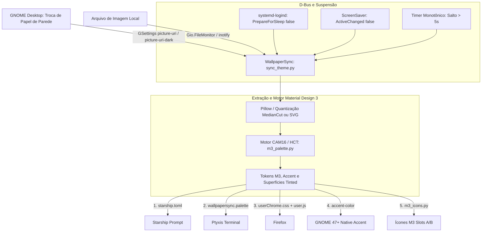

# WallpaperSync

Sincronizador dinâmico de temas e pacote de ícones **Material Design 3** para desktop Linux (GNOME), extraindo a paleta de cores diretamente do papel de parede ativo.

---

## 1. Visão Geral

O **WallpaperSync** detecta o papel de parede ativo (via GSettings/GNOME, XML de slideshow ou arquivo local), extrai a cor de destaque dominante com quantização adaptativa e gera tokens tonais **Material Design 3 (CAM16 / HCT)** para sincronizar automaticamente:

- **Pacote de Ícones Dinâmico Material Design 3** (`WallpaperSync-M3-A` / `WallpaperSync-M3-B`):
  - Pastas (`places/`) e tipos de arquivo (`mimetypes/`) em SVG seguindo os tokens tonais M3.
  - Filtro tonal M3 aplicado aos ícones originais de **todos os aplicativos instalados** (`.desktop` de sistema, usuário, Flatpak, Snap e **AppImage**), preservando 100% da silhueta, transparência e geometria original.
- **Prompt do Terminal (`Starship`)** (`~/.config/starship.toml`).
- **Emulador de Terminal GNOME (`Ptyxis`)** (`wallpapersync.palette` + atualização via GSettings).
- **Navegador Web `Firefox`** (`userChrome.css` e `user.js` em todos os perfis ativos, com suporte a abas horizontais e verticais).
- **Cor de Destaque Nativa do GNOME 47+** (`org.gnome.desktop.interface accent-color`).

> [!NOTE]
> **Sem dependências de extensões externas**: toda a extração de cores e o cálculo da paleta Material Design 3 são executados nativamente em Python por [sync_theme.py](sync_theme.py), [m3_palette.py](m3_palette.py) e [m3_icons.py](m3_icons.py).

---

## 2. Arquitetura e Fluxo de Execução



---

## 3. Requisitos e Instalação

### Dependências

- **Python 3.10+**
- **Pillow (`PIL`)**: extração de cores do wallpaper e filtro tonal M3 em ícones raster (`.png`, `.webp`, `.jpg`, `.ico` e PNGs embutidos em SVG).
  ```bash
  sudo apt install python3-pil
  # ou via pip: pip install pillow
  ```
- **PyGObject (`python3-gi`)** *(recomendado para `--watch`)*: monitoramento em tempo real via GSettings, `Gio.FileMonitor` e sinais D-Bus de suspensão/desbloqueio.
  ```bash
  sudo apt install python3-gi gir1.2-gio-2.0
  ```
- **Ferramentas do ambiente** *(opcionais, conforme os apps que você utiliza)*: `gsettings` (GNOME), `starship`, `Ptyxis`, `Firefox`.

### Instalação Rápida

```bash
git clone https://github.com/PedroMachado1/WallpaperSync.git
cd WallpaperSync

# Teste uma sincronização única
python3 sync_theme.py

# Instale e habilite o serviço automático de sessão (systemd --user)
python3 sync_theme.py --install-service
systemctl --user daemon-reload
systemctl --user enable --now wallpapersync.service
```

> `--install-service` gera automaticamente `~/.config/systemd/user/wallpapersync.service` apontando para o interpretador Python atual e para o caminho real onde o repositório foi clonado.

---

## 4. Detalhes dos Módulos e Integrações

### 4.1. Núcleo (`sync_theme.py`)

1. **Detecção do Papel de Parede (`get_current_wallpaper_path`)**:
   - Lê `org.gnome.desktop.interface color-scheme` e consulta `picture-uri-dark` ou `picture-uri` em `org.gnome.desktop.background`.
   - Converte URIs `file://`, decodifica caracteres especiais, resolve slideshows `.xml` do GNOME e possui fallbacks (`~/.fehbg` e diretórios padrão de wallpapers).
2. **Extração e Matemática de Cores (`extract_wallpaper_colors`)**:
   - Redimensiona a imagem para processamento rápido e aplica quantização adaptativa de 24 cores (`MedianCut`).
   - Pontua cores candidatas equilibrando população, saturação e luminosidade:
     $$\text{Score} = \text{População}^{0.55} \times \text{Saturação}^{1.4} \times \text{FatorLuminosidade}$$
   - Calcula automaticamente o *tint intensity* (`0.08` a `0.14`) conforme a saturação média do wallpaper e também suporta papéis de parede vetoriais em `.svg`.
3. **Cache de Estado (`$XDG_RUNTIME_DIR/wallpapersync.state`)**:
   - Evita reprocessamento redundante quando wallpaper, esquema de cores, modo de ícones e `--icon-tint` não mudaram (a menos que `--force` seja usado).

### 4.2. Pacote de Ícones Dinâmico Material Design 3 (`m3_palette.py` & `m3_icons.py`)

1. **Motor CAM16 / HCT (`m3_palette.py`)**:
   - Implementação em Python puro de `SchemeTonalSpot` (Material Design 3), derivando tokens para **Dark** e **Light** (`primary`, `secondary`, `tertiary`, `error`, `surfaceContainer*`, `outlineVariant`) com contraste WCAG verificado.
   - Gera tabelas de consulta perceptuais (`build_icon_tint_luts`) para mapear ícones originais para a paleta do wallpaper mantendo luzes, sombras, brancos e contraste.
2. **Pastas, Mimetypes e Filtro Tonal em Todos os Apps (`m3_icons.py`)**:
   - Cria os ícones M3 em `~/.local/share/icons/WallpaperSync-M3-{A,B}/scalable/` para `places/` e `mimetypes/`.
   - Varre todos os `.desktop` instalados (sistema, usuário, Flatpak, Snap, **AppImage** e `XDG_DATA_DIRS`) e busca seus ícones em temas instalados, diretórios `pixmaps/` e ícones soltos em `~/.local/share/icons/` ou `~/.icons/`.
   - Aplica o filtro tonal M3 sobre `.svg`, `.svgz`, `.png`, `.webp`, `.jpg` e `.ico` sem alterar formato, contorno, transparência ou geometria original.
   - Constrói a cadeia `Inherits=` no `index.theme` priorizando temas locais existentes (`MoreWaita`, `Papirus-Dark`/`Papirus`, `Adwaita`, `hicolor`).
3. **Ponte Reversível para AppImages (`.desktop` com caminho absoluto)**:
   - Aplicativos AppImage costumam definir `Icon=/caminho/absoluto/...` no `.desktop` do usuário (`~/.local/share/applications/`), o que faz o GNOME ignorar o tema de ícones ativo.
   - O WallpaperSync copia o ícone original para `hicolor`, registra o valor original em `~/.local/share/icons/.wallpapersync_desktop_icons.json` e troca `Icon=` para um nome de ícone temável.
   - Ao executar `--uninstall`, todos os `.desktop` modificados são restaurados exatamente para o valor original.
4. **Modos de Ícones (`--icon-mode` / `WALLPAPERSYNC_ICON_MODE`)**:
   - `system` ou `full` *(padrão)*: pastas e mimetypes M3 + **todos os aplicativos instalados** com filtro tonal M3 sobre os ícones originais (intensidade ajustável via `--icon-tint`, padrão `0.90`).
   - `places`: apenas pastas, locais e mimetypes M3.
   - `squircle`: estilo opcional com squircles Material You padronizados para apps principais.
   - `off`: desativa a geração de ícones.
5. **Hot-Reload Atômico no GNOME**:
   - Alterna entre os dois slots `WallpaperSync-M3-A` ↔ `WallpaperSync-M3-B` via `gsettings`, forçando GNOME Shell e Nautilus a recarregar os ícones na hora. O tema anterior é salvo em `.wallpapersync_prev_icon_theme` para restauração no `--uninstall`.

### 4.3. Starship, Ptyxis, Firefox e GNOME Accent

- **Starship (`~/.config/starship.toml`)**: atualiza `[palettes.wallpapersync]` (e mantém `[palettes.chromaleon]` por compatibilidade) com `palette = 'wallpapersync'`.
- **Ptyxis (`~/.local/share/org.gnome.Ptyxis/palettes/`)**: gera `wallpapersync.palette` (além de caminhos Flatpak se presentes) e configura todos os perfis via GSettings (`org.gnome.Ptyxis.Profile`).
- **Firefox**: localiza perfis em `~/.config/mozilla/firefox/` e `~/.mozilla/firefox/` via `profiles.ini`, ativa `toolkit.legacyUserProfileCustomizations.stylesheets = true;` em `user.js` e grava `chrome/userChrome.css` com suporte a abas horizontais, barra lateral e abas verticais.
- **GNOME 47+**: mapeia a cor de destaque extraída para a chave nativa `accent-color` em `org.gnome.desktop.interface`.

### 4.4. Automação em Tempo Real (`--watch`)

- **GSettings + `Gio.FileMonitor`**: reage imediatamente à troca de papel de parede, alteração de `color-scheme` (claro/escuro) ou sobrescrita do arquivo da imagem.
- **Retorno de Suspensão e Desbloqueio (3 camadas)**:
  1. D-Bus do sistema (`org.freedesktop.login1.Manager.PrepareForSleep` = `false`);
  2. D-Bus da sessão (`org.gnome.ScreenSaver` / `org.freedesktop.ScreenSaver` `ActiveChanged` = `false`);
  3. Fallback por salto monotônico (`time.monotonic()` > 5s entre ciclos).

---

## 5. Arquivos do Projeto e Destinos no Sistema

| Arquivo / Caminho | Origem / Destino | Função |
|---|---|---|
| `sync_theme.py` | Repositório | Orquestrador principal, extração de cores, CLI, daemon e D-Bus |
| `m3_palette.py` | Repositório | Motor CAM16 / HCT Material Design 3 e geração de LUTs de tint |
| `m3_icons.py` | Repositório | Gerador SVG M3, filtro tonal em apps/AppImages e hot-reload de slots |
| `wallpapersync.service` | Repositório | Modelo de referência da unit systemd do usuário |
| `firefox-userChrome.css` | Gerado localmente | Cópia de referência do `userChrome.css` gerado |
| `tests/test_m3_icons.py` | Repositório | Suíte de testes unitários para HCT, recoloração, bridge e slots |
| `~/.local/share/icons/WallpaperSync-M3-{A,B}/` | Gerado por `m3_icons.py` | Slots alternados do tema de ícones Material Design 3 |
| `~/.local/share/icons/.wallpapersync_prev_icon_theme` | Gerado por `m3_icons.py` | Backup do tema de ícones original do usuário |
| `~/.local/share/icons/.wallpapersync_desktop_icons.json` | Gerado por `m3_icons.py` | Mapa de restauração de `.desktop` (ex.: AppImages) |
| `~/.config/systemd/user/wallpapersync.service` | Gerado por `--install-service` | Serviço systemd do usuário para `--watch` |
| `~/.config/starship.toml` | Sistema | Paleta dinâmica aplicada ao prompt Starship |
| `~/.local/share/org.gnome.Ptyxis/palettes/wallpapersync.palette` | Sistema / Flatpak | Paleta dinâmica do terminal Ptyxis |
| `~/.config/mozilla/firefox/<perfil>/chrome/userChrome.css` | Sistema | Estilos dinâmicos aplicados ao Firefox |
| `~/.config/mozilla/firefox/<perfil>/user.js` | Sistema | Habilita carregamento do `userChrome.css` |

---

## 6. Guia de Linha de Comando (CLI) e Variáveis de Ambiente

### Variáveis de Ambiente

| Variável | Valores | Padrão | Descrição |
|---|---|---|---|
| `WALLPAPERSYNC_ICON_MODE` | `system`, `full`, `places`, `squircle`, `off` | `system` | Define o modo padrão do gerador de ícones M3 |
| `WALLPAPERSYNC_ICON_TINT` | `0.0` a `1.0` | `0.90` | Define a intensidade padrão do filtro tonal M3 nos ícones de apps |

### Comandos Principais

```bash
# Sincronização única com o wallpaper ativo
python3 sync_theme.py

# Forçar reaplicação escolhendo modo e intensidade do filtro dos ícones
python3 sync_theme.py --icon-mode system --icon-tint 0.90 --force

# Sobrescrever cor de destaque (#HEX) e intensidade de tint manualmente
python3 sync_theme.py --accent "#7aa2f7" --tint 0.12 --force

# Sincronizar sem gerar/alterar ícones
python3 sync_theme.py --no-icons

# Gerar pré-visualização HTML da paleta M3 e dos ícones
python3 sync_theme.py --preview-icons

# Exibir diagnóstico do wallpaper ativo, cor extraída e paleta M3
python3 sync_theme.py --info

# Sincronizar a partir de uma imagem específica
python3 sync_theme.py --image /caminho/para/wallpaper.jpg

# Executar daemon de monitoramento em tempo real
python3 sync_theme.py --watch
```

### Gerenciamento do Serviço e Desinstalação

```bash
# Instalar serviço systemd do usuário
python3 sync_theme.py --install-service

# Status, logs em tempo real e reinício
systemctl --user status wallpapersync.service
journalctl --user -u wallpapersync.service -f
systemctl --user restart wallpapersync.service

# Remover apenas o serviço systemd
python3 sync_theme.py --uninstall-service

# Desinstalação completa (remove serviço, slots M3, paletas, Firefox e restaura .desktop/ícones originais)
python3 sync_theme.py --uninstall
```

---

## 7. Testes Automatizados

Para validar a matemática de cores HCT, contraste WCAG, preservação de silhueta/alpha em PNG e SVG, ponte de AppImages e alternância de slots:

```bash
python3 -m unittest discover -s tests -v
```
