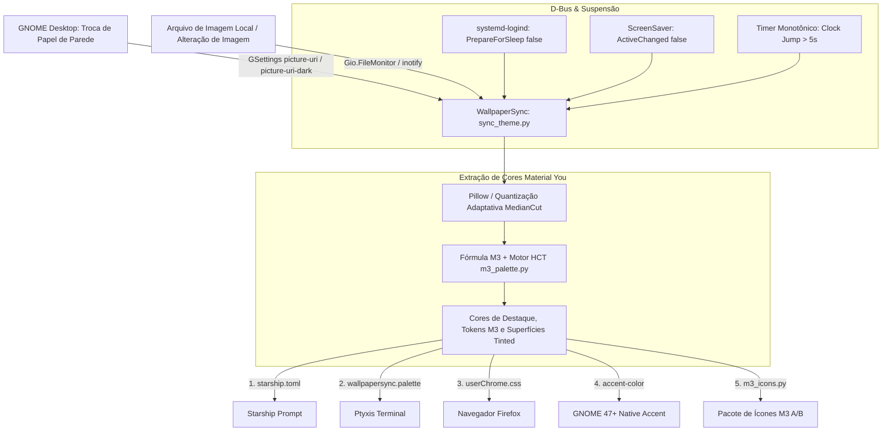

# WallpaperSync — Documentação Técnica e Arquitetura

Este documento serve como referência completa para desenvolvedores, mantenedores ou inteligências artificiais (LLMs) que venham a assumir o suporte e a evolução deste ecossistema.

---

## 1. Visão Geral do Projeto

O **WallpaperSync** é uma suíte de automação desenvolvida para extrair a paleta de cores dinâmica **diretamente do papel de parede ativo** do ambiente de desktop (GNOME, GSettings ou arquivo local) e sincronizá-la com aplicativos e ferramentas do sistema operacional:

- **Prompt do Terminal** (`starship.toml`);
- **Emulador de Terminal GNOME** (`Ptyxis`);
- **Navegador Web Firefox** (estilização dinâmica de abas horizontais e verticais, barra de URL e navegação via `userChrome.css`);
- **Ambiente GNOME Desktop** (sincronização automática da chave nativa `accent-color` no GNOME 47+);
- **Pacote de Ícones Material Design 3** (geração dinâmica de SVGs para pastas e mimetypes + filtro tonal M3 preservando o formato original de todos os aplicativos em `~/.local/share/icons/WallpaperSync-M3-{A,B}`).

> [!NOTE]
> **Independência de Extensões**: O projeto não depende mais da extensão ChromaLeon nem de arquivos intermediários GTK (`custom-accent.css`). Toda a extração e cálculo de cores é realizada nativamente em Python via análise de imagem (Pillow), quantização adaptativa tonal e motor HCT do Material Design 3 (`m3_palette.py`).

---

## 2. Arquitetura e Fluxo de Execução



---

## 3. Componentes e Lógica de Implementação

### 3.1. Núcleo: `sync_theme.py`
O script central executa as seguintes etapas:
1. **Detecção do Papel de Parede (`get_current_wallpaper_path`)**:
   - Detecta o esquema de cores ativo (`org.gnome.desktop.interface color-scheme`).
   - Busca `picture-uri-dark` (no modo escuro) ou `picture-uri` no schema `org.gnome.desktop.background`.
   - Converte URIs `file://` para caminhos de sistema de arquivos e decodifica caracteres especiais.
   - Suporta arquivos `.xml` de slideshows do GNOME e fallbacks como `~/.fehbg` ou diretórios de papéis de parede comuns.
2. **Extração e Matemática de Cores (`extract_wallpaper_colors`)**:
   - Redimensiona a imagem para análise sub-20ms.
   - Aplica quantização adaptativa de 24 cores (MedianCut).
   - Avalia cada cor candidata através de pontuação de contraste e vivacidade para temas escuros:
     $$\text{Score} = \text{População}^{0.55} \times \text{Saturação}^{1.4} \times \text{FatorLuminosidade}$$
   - Calcula automaticamente o *tint intensity* (8% a 14%) com base na saturação média do wallpaper.
   - Suporta papéis de parede vetoriais em `.svg` (análise de gradientes e paradas de cor).
3. **Distribuição**:
   - Atualiza os arquivos no diretório do projeto e propaga para os destinos mapeados no sistema.

---

### 3.2. Prompt Starship & Terminal Ptyxis

1. **Starship (`~/.config/starship.toml`)**:
   - `sync_theme.py` atualiza a seção `[palettes.wallpapersync]` (e mantém `[palettes.chromaleon]` para retrocompatibilidade) e define `palette = 'wallpapersync'`, injetando a cor primária, variações e fundos tingidos nos componentes do prompt.
2. **Ptyxis (`~/.local/share/org.gnome.Ptyxis/palettes/`)**:
   - Gera as paletas `wallpapersync.palette` e `chromaleon.palette` com `Primary=true` utilizando o tom do wallpaper como cor de fundo da janela, barra de títulos e cursor.
   - Seta via GSettings (`org.gnome.Ptyxis.Profile`) a paleta padrão e todos os perfis cadastrados (`profile-uuids`) com o ID `wallpapersync`.

---

### 3.3. Navegador Web Firefox (`userChrome.css` & `user.js`)

1. **Descoberta de Perfis**:
   - Varre automaticamente `~/.config/mozilla/firefox/` e `~/.mozilla/firefox/`, analisando o `profiles.ini` para localizar perfis ativos.
2. **Ativação Automática de Estilos (`user.js`)**:
   - Garante a injeção da preferência `toolkit.legacyUserProfileCustomizations.stylesheets = true;` no arquivo `user.js` de cada perfil.
3. **Estilização Dinâmica (`userChrome.css`)**:
   - Injeta as cores da paleta Material You nas variáveis nativas do Firefox.
   - Fornece suporte tanto para o layout tradicional de **abas horizontais** quanto para o modo de **abas verticais** (*Vertical Tabs*), colorindo abas ativas, bordas de foco da barra de URL e botões em hover.

---

### 3.4. Pacote de Ícones Dinâmico Material Design 3 (`m3_palette.py` & `m3_icons.py`)

1. **Motor de Cores HCT (`m3_palette.py`)**:
   - Implementação em Python puro do modelo CAM16 / HCT do Material Design 3 (`SchemeTonalSpot`), derivando paletas tonais (`primary`, `secondary`, `tertiary`, `error`, `surfaceContainer*`, `outlineVariant`) para modos **Dark** e **Light** com contraste WCAG verificado.
   - Gera também tabelas LUT perceptuais (`build_icon_tint_luts`) para mapear ícones existentes para a matiz do papel de parede mantendo luminância, sombras e brancos/pretos legíveis.
2. **Pastas, Mimetypes e Filtro Tonal para Todos os Apps (`m3_icons.py`)**:
   - Gera ícones vetoriais M3 em `~/.local/share/icons/WallpaperSync-M3-{A,B}/scalable/` para pastas (`places/`) e tipos de arquivo (`mimetypes/`).
   - Descobre todos os aplicativos instalados (`.desktop` em sistema, usuário, Flatpak, Snap, AppImage e `XDG_DATA_DIRS`), localiza o ícone original de cada app (`.svg`, `.svgz`, `.png`, `.webp`, `.jpg`, `.ico`) e aplica o **filtro tonal M3 mantendo 100% do formato, silhueta, transparência e geometria original** em `scalable/apps/` e `256x256/apps/`.
   - Monta automaticamente a cadeia `Inherits=` no `index.theme` priorizando temas instalados no sistema (`MoreWaita`, `Papirus-Dark`/`Papirus`, `Adwaita`, `hicolor`).
3. **Modos de Ícones (`--icon-mode` ou `WALLPAPERSYNC_ICON_MODE`)**:
   - `system` / `full` *(padrão)*: pastas e mimetypes em M3 + **todos os apps instalados** com filtro de cor Material Design 3 sobre seus ícones originais. A intensidade do filtro pode ser ajustada com `--icon-tint` (ou `WALLPAPERSYNC_ICON_TINT`, padrão `0.90`).
   - `places`: apenas pastas, locais e mimetypes.
   - `squircle`: estilo opcional com squircles uniformes Material You para apps principais.
   - `off`: desativa a geração de ícones.
4. **Hot-Reload Atômico no GNOME**:
   - Alterna automaticamente entre dois slots (`WallpaperSync-M3-A` ↔ `WallpaperSync-M3-B`) via `gsettings`, forçando o Nautilus e o GNOME Shell a recarregarem os ícones instantaneamente sem reiniciar a sessão. O tema original do usuário é salvo para restauração no `--uninstall`.

---

## 4. Automação e Ciclo de Vida (systemd & D-Bus)

### 4.1. Serviço do Usuário
O serviço roda sob a sessão do systemd do usuário:
- **Arquivo**: `~/.config/systemd/user/wallpapersync.service`
- **Comando executado**: `python3 -u /home/pedro/Imagens/Wallpapers/WallpaperSync/sync_theme.py --watch`

### 4.2. Detecção de Mudança de Wallpaper em Tempo Real
- **GSettings**: O script conecta sinais de monitoramento direto nas chaves `picture-uri` e `picture-uri-dark` (`org.gnome.desktop.background`) e `color-scheme` (`org.gnome.desktop.interface`).
- **File Monitor**: Cria um `Gio.FileMonitor` diretamente no arquivo de imagem do wallpaper ativo. Se uma ferramenta externa ou script sobrescrever a imagem, a atualização é acionada instantaneamente.

### 4.3. Retorno de Suspensão (Sleep / Wakeup / Lockscreen)
- **3 Camadas de Detecção**:
  1. **D-Bus do Sistema (`systemd-logind`)**: Escuta o sinal `org.freedesktop.login1.Manager.PrepareForSleep`. Quando o booleano for `false` (acordando), aciona a sincronização.
  2. **D-Bus da Sessão (`ScreenSaver`)**: Escuta `ActiveChanged` de `org.gnome.ScreenSaver` e `org.freedesktop.ScreenSaver`. Quando o valor for `false` (tela desbloqueada), aciona a sincronização.
  3. **Salto Temporal (Fallback)**: Um timer de 1 segundo compara `time.monotonic()`. Se a diferença entre dois ciclos for maior que 5 segundos, a máquina comprovadamente esteve suspensa e acabou de retomar.

---

## 5. Mapeamento de Arquivos e Diretórios

| Arquivo / Caminho | Origem / Destino | Função |
|---|---|---|
| `/home/pedro/Imagens/Wallpapers/WallpaperSync/sync_theme.py` | Código-fonte principal | Daemon de monitoramento, conversão de cores e controle D-Bus |
| `/home/pedro/Imagens/Wallpapers/WallpaperSync/m3_palette.py` | Módulo M3 | Motor de cores CAM16 / HCT e tokens tonais Material Design 3 |
| `/home/pedro/Imagens/Wallpapers/WallpaperSync/m3_icons.py` | Módulo M3 Icons | Gerador de SVGs Freedesktop, filtro tonal M3 e hot-reloader de slots no GNOME |
| `/home/pedro/Imagens/Wallpapers/WallpaperSync/firefox-userChrome.css` | Gerado por `sync_theme.py` | Cópia local de referência do tema do Firefox |
| `~/.local/share/icons/WallpaperSync-M3-{A,B}/` | Gerado por `m3_icons.py` | Slots alternados do pacote de ícones dinâmico Material Design 3 |
| `~/.config/systemd/user/wallpapersync.service` | Serviço systemd | Autostart do monitoramento no login do usuário |
| `~/.config/starship.toml` | Arquivo do sistema | Configuração do prompt do shell |
| `~/.local/share/org.gnome.Ptyxis/palettes/wallpapersync.palette` | Paleta gerada | Paleta dinâmica para o terminal Ptyxis |
| `~/.config/mozilla/firefox/<perfil>/chrome/userChrome.css` | Arquivo gerado | Estilos dinâmicos de interface para o Firefox |
| `~/.config/mozilla/firefox/<perfil>/user.js` | Arquivo de preferências | Ativa a leitura do `userChrome.css` no Firefox |

---

## 6. Guia de Operação e Linha de Comando (CLI)

### Comandos Rápidos

- **Executar sincronização única (utilizando o wallpaper ativo atual)**:
  ```bash
  python3 sync_theme.py
  ```

- **Escolher o modo do pacote de ícones Material Design 3 (`system`, `full`, `places`, `squircle`, `off`) e força do filtro (`--icon-tint`)**:
  ```bash
  python3 sync_theme.py --icon-mode system --icon-tint 0.90 --force
  ```

- **Gerar pré-visualização HTML interativa da paleta e dos ícones M3**:
  ```bash
  python3 sync_theme.py --preview-icons
  ```

- **Ver informações do papel de parede detectado, paleta M3 e cores calculadas**:
  ```bash
  python3 sync_theme.py --info
  ```

- **Sincronizar a partir de uma imagem de wallpaper específica**:
  ```bash
  python3 sync_theme.py --image /caminho/para/meu_wallpaper.jpg
  ```

- **Iniciar monitoramento em tempo real**:
  ```bash
  python3 sync_theme.py --watch
  ```

- **Instalar o serviço do systemd para iniciar automaticamente com a sessão**:
  ```bash
  python3 sync_theme.py --install-service
  ```

- **Verificar status do serviço em segundo plano**:
  ```bash
  systemctl --user status wallpapersync.service
  ```

- **Ver logs em tempo real**:
  ```bash
  journalctl --user -u wallpapersync.service -f
  ```

- **Reiniciar o serviço após alterações**:
  ```bash
  systemctl --user restart wallpapersync.service
  ```

- **Desinstalar apenas o serviço em segundo plano (systemd)**:
  ```bash
  python3 sync_theme.py --uninstall-service
  ```

- **Desinstalação completa (remove serviços, temas gerados, paletas e restaura aplicativos)**:
  ```bash
  python3 sync_theme.py --uninstall
  ```
